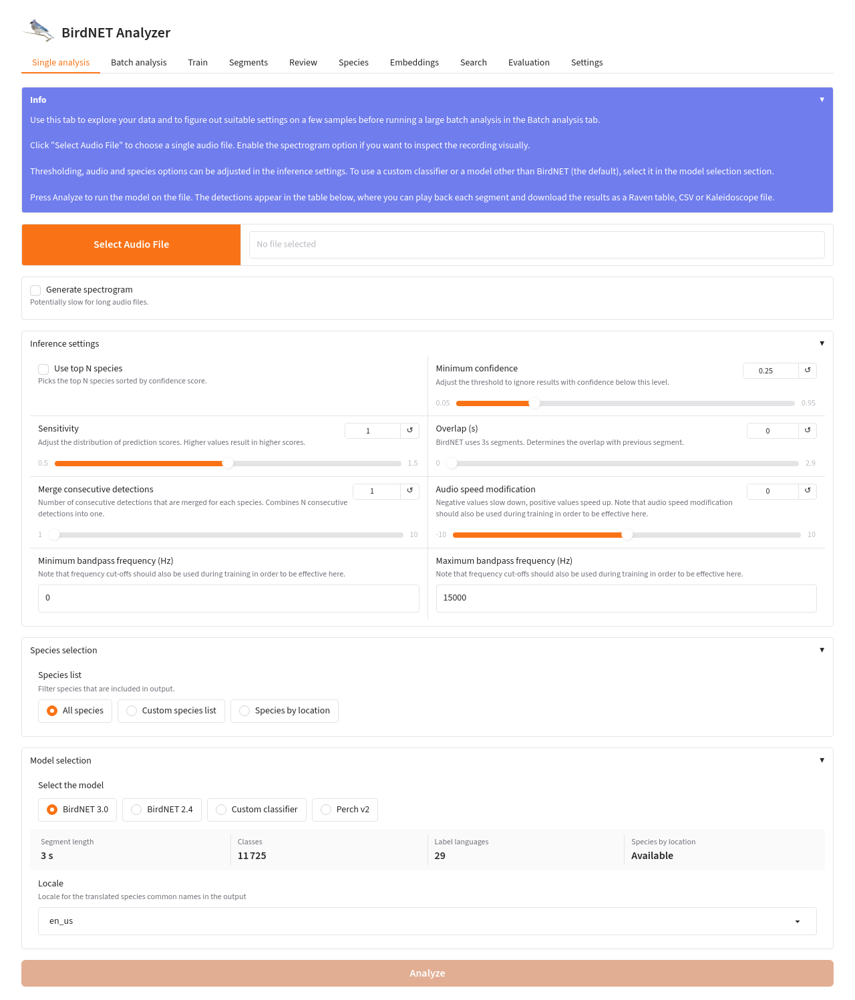

GUI
===

We provide a stand-alone GUI which lets you launch the analysis through a web interface.

To use the GUI, install the package with the ``gui`` extra: ``pip install "birdnet_analyzer[gui]"``

Launch the GUI with ``python -m birdnet_analyzer.gui``.

Set all folders and parameters, after that, click 'Analyze'. GUI items represent the command line arguments.
For more information about the command line arguments, please refer to the :ref:`Command line interface documentation <cli-docs>`.

`Alternatively download the installer to run the GUI on your system`.

Pausing and resuming a batch analysis
-------------------------------------

A running batch analysis can be interrupted with the **Pause** button — the progress
made so far is kept in the output folder. To continue later (even after closing the
GUI), select the same input and output folders again: a status line shows how many
files were already analyzed and the start button changes to **Continue analysis**.
The same happens after a crash or power loss, since progress is saved continuously
while the analysis runs.

Continuing uses the settings *currently set in the GUI*, not the ones the
interrupted run started with. Settings that affect the detections — the model,
minimum confidence, species list, and so on — must therefore be left unchanged (or
restored by loading the run's ``*-params.csv`` file); if one of them differs, the
saved progress is discarded and the analysis starts over. Output settings such as
the output format or additional columns may be changed freely. See
:ref:`resumable-analysis` for the details.

Segment review
--------------

Please read the paper from `Connor M. Wood and Stefan Kahl: Guidelines for appropriate use of BirdNET scores and other detector outputs <https://scholar.google.com/citations?view_op=view_citation&hl=en&user=Uwta4wYAAAAJ&sortby=pubdate&citation_for_view=Uwta4wYAAAAJ:j3f4tGmQtD8C>`_.

The **Review** tab in the GUI is an implementation of the workflow described in the paper.
It allows you to review the segments that were detected by BirdNET and to verify the segments manually.
This can help you to choose an appropriate cut-off threshold for your specific use case.

General workflow:

1. Use the **Segments** tab in the GUI or the :ref:`birdnet_analyzer.segments <cli-segments>` script to extract short audio segments for species detections.
2. Open the **Review** tab in the GUI and select the parent directory containing the directories for all the species you want to review.
3. Review the segments and manually check "positive" if the segment does contain target species or "negative" if it does not.

For each selected sample the logistic regression curve is fitted and the threshold is calculated.

Log files
---------

The installed application keeps two files that help to find the cause of a problem. Please attach them when you report
one on `GitHub <https://github.com/birdnet-team/BirdNET-Analyzer/issues>`_.

- ``error_log.txt`` holds the errors, which the **Settings** tab shows as well.
- ``logs.txt`` holds everything else the application prints. On Linux it is written when the application was started
  from the applications menu or a file manager; started from a terminal, the application prints there instead.

Both are in ``%APPDATA%\BirdNET-Analyzer-GUI`` on Windows, ``~/Library/Application Support/BirdNET-Analyzer-GUI`` on
macOS and ``~/.local/share/BirdNET-Analyzer-GUI`` on Linux. A file that has grown too large is continued in a new one,
and the previous one is kept with ``.1`` added to its name.

GUI Language
------------

The default language of the GUI is English, but you can change it to German, Finnish, French, Indonesian, Brazilian Portuguese, Russian, Swedish, Simplified Chinese or Traditional Chinese in the Settings tab of the GUI.
If you want to contribute a translation to another language you, use the files inside the lang folder as a template.
You can then send us the translated files or create a pull request.
To check your translation, place your file inside the ``lang`` folder and start the GUI, your language should now be available in the **Settings** tab.
After selecting your language, you should restart the GUI to apply the changes.

We thank our collaborators for contributing translations:

Chinese: Sunny Tseng (`@Sunny Tseng <https://github.com/SunnyTseng>`_)

French: `@FranciumSoftware <https://github.com/FranciumSoftware>`_

Portuguese: Larissa Sugai (`@LSMSugai <https://github.com/LSMSugai>`_)

Russian: Александр Цветков (cau@yandex.ru, radio call sign: R1BAF)
